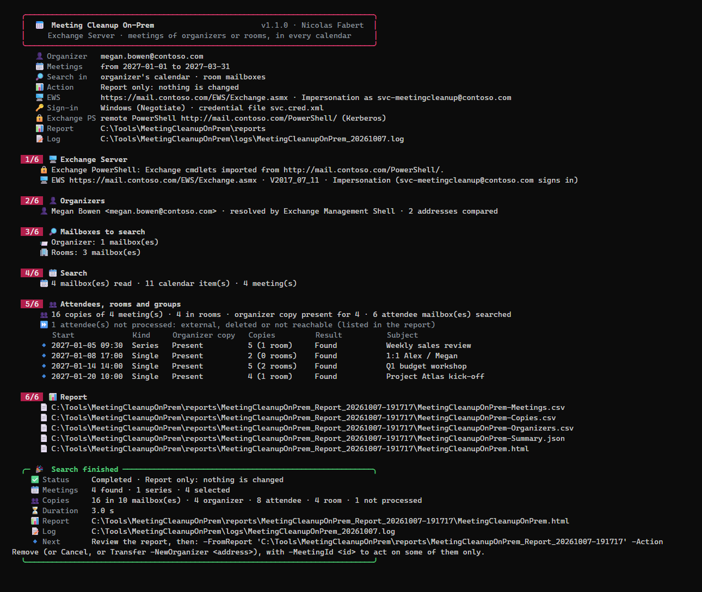

# Meeting Cleanup On-Prem — User guide

> What you need before the first run, then one command per everyday question: **which meetings does this person still organize?**, **a person has left: cancel their meetings, or give them to someone else?**, **one series to remove without a message**, **one occurrence of a series**, **rooms closed for works**, **undo a removal**. How the tool works, the rights in detail, the configuration, the report and the internals are in the [developer guide](MeetingCleanupOnPrem-Guide.md).

> [!IMPORTANT]
> Files downloaded from the Internet may be blocked by Windows and fail to run. After extracting the release ZIP, unblock every file of the folder (step 3 of the one-time setup):
>
> ```powershell
> Get-ChildItem "C:\Tools\MeetingCleanupOnPrem-1.1.1" -Recurse -File -Force | Unblock-File
> ```
>
> Replace the example path with the folder where you extracted the ZIP.

> [!NOTE]
> **Check the download.** Get the tool only from the [Releases page](https://github.com/Nico77600/MeetingCleanupOnPrem/releases/latest), file `MeetingCleanupOnPrem-1.1.1.zip` (not the *Source code* archives). The release page shows the SHA256 of the ZIP. Before extracting, compute it and compare:
>
> ```powershell
> Get-FileHash "$env:USERPROFILE\Downloads\MeetingCleanupOnPrem-1.1.1.zip" -Algorithm SHA256
> ```
>
> The two values must be identical. After extracting, check the signature of the entry script:
>
> ```powershell
> Get-AuthenticodeSignature C:\Tools\MeetingCleanupOnPrem-1.1.1\Invoke-MeetingCleanupOnPrem.ps1 | Format-List Status, SignerCertificate
> ```
>
> **You should see:** `Status : Valid` and a signer named *Nicolas Fabert*. On every run the tool also checks, before anything loads, the signature of its PowerShell files and the SHA256 of each file against the signed list `PackageIntegrity.psd1`.
>
> **If the tool stops with a *Package integrity* message:** nothing was run. *Unexpected stable file*: a file that is not part of the package is in the tool folder; move your own files to the data folder (see below). *SHA256 mismatch*, *missing inventory path*, *expected trusted, timestamped owner signature*, *PackageIntegrity.psd1 is missing*: a file of the package was changed, removed or is not signed; download the ZIP again from the Releases page, extract it into a new folder and unblock it. The only file you edit is `config\MeetingCleanupOnPrem.config.psd1`. Keep your own files (credential file, lists of addresses) in a folder outside the tool folder, for example `C:\Tools\MeetingCleanupOnPrem-data`: inside the tool folder only `config\MeetingCleanupOnPrem.config.psd1`, `reports\` and `logs\` may change. Do not use `-DevelopmentMode` on a release package: it is for developers.
```cards
checklist | Prerequisites | Chapter 1: PowerShell, the service account and its rights, then the one-time setup.
terminal | Everyday use | Chapter 2: one command per question, in the console or in a scheduled task.
filter | Choose the meetings | Chapter 3: who, where to search, which period, which meetings, which server.
file | Results | Chapter 4: where the report is written, exit codes, the usual messages.
```

<!-- icon: checklist -->
## 1. Prerequisites

| Item | Requirement |
|---|---|
| Exchange | **Exchange Server 2016, 2019 or Subscription Edition**, with EWS reachable over HTTPS. Validated on Exchange Server 2019. For Exchange Online, use [Meeting Cleanup](https://github.com/Nico77600/MeetingCleanup). |
| PowerShell | **PowerShell 7.4 or later** (the program `pwsh`). Windows PowerShell 5.1 (`powershell.exe`, the one built into Windows) is not enough. A portable zip of PowerShell is enough. No module to install. |
| Windows | Windows 10 / 11, Windows Server 2016 to 2025: an administration workstation or an Exchange server. The tool runs in a console, or in a scheduled task. |
| Service account | An account with the role **ApplicationImpersonation** (it opens the calendars through EWS), preferably limited to the mailboxes concerned by a management scope ([developer guide, chapter 5](MeetingCleanupOnPrem-Guide.md#5-rights-and-connection)). `Delegate` (full access to each mailbox) works as well. |
| Exchange PowerShell | Recommended: the tool connects to it alone. It resolves aliases and X500 addresses, lists every room and every mailbox, expands the groups and runs *Restore*. Rights: [Rights for the directory](MeetingCleanupOnPrem-Guide.md#rights-for-the-directory), [Rights for Restore](MeetingCleanupOnPrem-Guide.md#rights-for-restore). |
| Network | HTTPS to the EWS URL (`https://mail.contoso.com/EWS/Exchange.asmx`); HTTP to `/PowerShell/` of a Mailbox server for remote PowerShell. |

Terms you will meet:

| Term | In plain words |
|---|---|
| **EWS** (Exchange Web Services) | The web address of your Exchange server that the tool uses to read and change calendars. |
| **Impersonation** (ApplicationImpersonation) | An Exchange role that lets the service account open other people's calendars as if it were them. |
| **RPS** (remote PowerShell) | The Exchange command line, opened by the tool from your computer. It looks up addresses, rooms and groups. |
| **Management scope** | An Exchange filter that limits a role to some mailboxes, here user, room and shared mailboxes. |
| **X500 address** | The old internal address of a mailbox, kept in the meetings after the mailbox is deleted. |
| **Recoverable Items** | The hidden folder of a mailbox where deleted items stay for the retention time (14 days by default); *Restore* reads it. |
| **FQDN** | The full name of a server, such as `mail.contoso.com`. |
| **SHA256** | A fingerprint of a file: two files with the same SHA256 are identical. |
| **Kerberos / NTLM** | Two ways Windows proves who you are to a server. The default, `Negotiate`, picks one for you: leave it, and read step 6 if you get an HTTP 401 error. |

> [!WARNING]
> **ApplicationImpersonation** opens the calendar of every mailbox in its scope. Keep the account like an administrator account, limit it to the mailboxes concerned with a management scope, and store its password only as an encrypted credential file (step 8).

### 1.1 One-time setup

Eight steps, in this order. Each one says what to do, what you should see, and what to do if not.

#### Step 1 · Get the tool

**Do:** download `MeetingCleanupOnPrem-1.1.1.zip` from the [latest release](https://github.com/Nico77600/MeetingCleanupOnPrem/releases/latest), check it (box above), and extract it so that the folder is `C:\Tools\MeetingCleanupOnPrem-1.1.1`. No installer.

**You should see:** in that folder, `Invoke-MeetingCleanupOnPrem.ps1`, `README.md` and the folders `config`, `docs`, `src` and `templates`.

**If not:** the files are one level deeper (`C:\Tools\MeetingCleanupOnPrem-1.1.1\MeetingCleanupOnPrem-1.1.1\...`): move the inner folder up.

#### Step 2 · Open PowerShell 7 in the folder

**Do:** in File Explorer, open `C:\Tools\MeetingCleanupOnPrem-1.1.1`, click the address bar, type `pwsh` and press Enter. A PowerShell 7 window opens already in the right folder. Check the version:

```powershell
$PSVersionTable.PSVersion
```

**You should see:** `Major` 7 and `Minor` 4 or more. Keep this window open: every command below is run from this folder.

**If not:** `pwsh` is not recognized: install PowerShell 7 (`winget install --id Microsoft.PowerShell`, or the MSI from Microsoft), then open a new window. A version that starts with 5 means you opened Windows PowerShell: close it and use `pwsh`.

#### Step 3 · Unblock the files

**Do:**

```powershell
Get-ChildItem . -Recurse -File -Force | Unblock-File
```

**You should see:** no output and no error.

**If not:** *Access denied*: run the command as the account that extracted the ZIP, or ask for write access to the folder.

#### Step 4 · Create the service account and give it its rights

**Do:** create a user account, for example `svc-meetingcleanup`. In the Exchange Management Shell, as an Exchange administrator, run once:

```powershell
# Exchange Management Shell, as an Exchange administrator - once
New-ManagementScope -Name 'Meeting Cleanup scope' -RecipientRestrictionFilter "RecipientTypeDetails -eq 'UserMailbox' -or RecipientTypeDetails -eq 'RoomMailbox' -or RecipientTypeDetails -eq 'SharedMailbox'"
New-ManagementRoleAssignment -Name 'Meeting Cleanup impersonation' -Role ApplicationImpersonation -User svc-meetingcleanup -CustomRecipientWriteScope 'Meeting Cleanup scope'
Set-User svc-meetingcleanup -RemotePowerShellEnabled $true
Add-RoleGroupMember 'View-Only Organization Management' -Member svc-meetingcleanup
New-RoleGroup -Name 'Meeting Cleanup Restore' -Roles 'Mailbox Import Export' -Members svc-meetingcleanup   # for Restore only
```

The first command limits the account to user, room and shared mailboxes. The second gives it the impersonation role inside that limit. The third lets it open remote PowerShell. The fourth gives it read-only access to the directory. The last one is needed only if you will use *Restore*. Then check:

```powershell
Get-ManagementRoleAssignment -RoleAssignee svc-meetingcleanup | Select-Object Name, Role
```

**You should see:** a list that contains `ApplicationImpersonation` (and `Mailbox Import Export` if you created the Restore group).

**If not:** *The term 'New-ManagementScope' is not recognized*: you are not in the Exchange Management Shell; open it on an Exchange server. *already exists*: the object was created earlier, go on with the next command. A new role can take some minutes to apply.

#### Step 5 · Find your EWS URL and your Exchange server name

**Do:** in the Exchange Management Shell:

```powershell
Get-WebServicesVirtualDirectory | Select-Object Server, InternalUrl, ExternalUrl
Get-ExchangeServer | Select-Object Name, Fqdn, ServerRole
```

**You should see:** a table with one line per server. The EWS URL ends with `/EWS/Exchange.asmx`: use the `InternalUrl` when you run the tool inside your network (the `ExternalUrl` otherwise). Servers behind a load balancer show the same URL: use that one. In the second table, take the `Fqdn` of a Mailbox server.

**If not:** the URL columns are empty: ask your Exchange administrator for the EWS address, it is the same one Outlook uses.

#### Step 6 · Fill in the configuration

**Do:** `notepad .\config\MeetingCleanupOnPrem.config.psd1`. Change only these settings and save. Here is a filled example for the company *Contoso*, with the service account `svc-meetingcleanup`:

```powershell
Connection = @{
    EwsUrl  = 'https://mail.contoso.com/EWS/Exchange.asmx'   # from step 5
    Mailbox = 'svc-meetingcleanup@contoso.com'               # the address of the service account
    # the other Connection settings keep their delivered values
}
Search = @{
    AcceptedDomains = @('contoso.com')                       # the e-mail domains of your organization
}
ManagementShell = @{
    ServerFqdn = 'mail.contoso.com'                          # the Fqdn of a Mailbox server, from step 5
}
```

Leave the other settings as delivered. `Connection.WindowsPackage` is `Negotiate`: Windows chooses Kerberos or NTLM by itself, which works in most organizations. Change it to `NTLM` only if step 7 stops with HTTP 401 and you reach EWS through a load balancer or an alias name.

**You should see:** nothing yet; the file is checked when the tool starts, and every wrong value is listed at once.

**If not:** a message starting with *Invalid value* names the setting: correct it and run the check of step 7 again.

#### Step 7 · Check the connection with a report

**Do:** run a report on your own address. A report changes nothing:

```powershell
.\Invoke-MeetingCleanupOnPrem.ps1 -Organizer jane.roe@contoso.com
```



**You should see:** the first lines can take up to a minute (the tool compiles its helper and opens remote PowerShell). Then the title card, then in step 1 a line *Exchange PowerShell: ...* and a line *EWS https://mail.contoso.com/EWS/Exchange.asmx ... Impersonation (svc-meetingcleanup@contoso.com signs in)*, then the steps of the search, and at the end the folder written under `reports\` with the next command to run. Open `MeetingCleanupOnPrem.html` in that folder.

**If not:** read the red message and find it in the table of chapter 4. The usual ones: *HTTP 401* (password, or step 6: `NTLM`), *ErrorImpersonateUserDenied* (step 4, wait a few minutes), *Exchange RPS connection failed* (`ManagementShell.ServerFqdn`).

#### Step 8 · Scheduled task (optional)

**Do:** to run the tool without typing a password, save the password of the service account in a credential file. Keep it in a data folder **outside** the tool folder (the tool refuses a tool folder that holds an unknown file). Run this as the account that will RUN the task: the file can only be read by that account, on this computer.

```powershell
New-Item -ItemType Directory -Force C:\Tools\MeetingCleanupOnPrem-data | Out-Null
Get-Credential CONTOSO\svc-meetingcleanup | Export-Clixml C:\Tools\MeetingCleanupOnPrem-data\svc.cred.xml
```

Then, in the configuration: `Connection.CredentialFile = 'C:\Tools\MeetingCleanupOnPrem-data\svc.cred.xml'`.

**You should see:** the file `svc.cred.xml` in `C:\Tools\MeetingCleanupOnPrem-data`, and the password is not readable in it.

**If not:** you closed the password window: run the command again.
<!-- icon: terminal -->
## 2. Everyday use

Run the commands from the tool folder, in PowerShell 7. A command without `-Action` is a **report**: it finds the meetings and every copy of them (organizer, attendees, rooms, members of the groups invited) and **changes nothing**. Read the report, then run the same command with an action: *Remove*, *Cancel*, *Transfer* and *Restore* show exactly what will happen and ask to type **YES**; a backup is written before any change.

> [!IMPORTANT]
> Always start with a report. A silent removal can be undone for 14 days (2.9); a **cancellation cannot be undone**: the attendees received it.

### 2.1 Which meetings does this person still organize?

```powershell
# The coming year (default), in the organizer's calendar and every room
.\Invoke-MeetingCleanupOnPrem.ps1 -Organizer megan.bowen@contoso.com

# A given period
.\Invoke-MeetingCleanupOnPrem.ps1 -Organizer megan.bowen@contoso.com -Start 2026-11-01 -End 2026-12-31
```

Open the HTML report: the **Meetings** tab lists each meeting (a series once), click one for its copies — who has it, which rooms, how it was found.

### 2.2 A person has left, the mailbox is kept: cancel the meetings

```powershell
.\Invoke-MeetingCleanupOnPrem.ps1 -Organizer megan.bowen@contoso.com -Action Cancel -Comment 'Megan Bowen has left: this meeting is cancelled.'
```

Each meeting is cancelled by its organizer, with your message: the attendees receive the cancellation, the rooms release the slot, the copies left are removed.

### 2.3 A person has left, the mailbox is deleted

```powershell
# Every room first, then every mailbox for the meetings without room
.\Invoke-MeetingCleanupOnPrem.ps1 -Organizer john.doe@contoso.com -SearchIn Rooms, AllMailboxes -Start 2026-10-01 -End 2027-03-31

# Then remove, without a message, exactly what the report found
.\Invoke-MeetingCleanupOnPrem.ps1 -FromReport .\reports\MeetingCleanupOnPrem_Report_20261006-101500 -Action Remove
```

Use the address of the person, or its **X500 address** when the account is gone from the directory (`/o=Contoso/ou=Exchange Administrative Group (...)/cn=Recipients/cn=...`): it is the organizer address the meetings still carry. A deleted organizer cannot cancel: the copies are removed silently. `AllMailboxes` needs Exchange PowerShell; with a list of the team instead: `-SearchIn Mailboxes -MailboxFile C:\Tools\MeetingCleanupOnPrem-data\team.txt`.

### 2.4 Give the meetings of a person to someone else

```powershell
.\Invoke-MeetingCleanupOnPrem.ps1 -Organizer john.doe@contoso.com -Action Transfer -NewOrganizer jane.roe@contoso.com
```

Jane becomes the organizer of every meeting still to come. Exchange Server cannot move a meeting to another organizer: each meeting is **re-created** in Jane's calendar and sent to every attendee and room in **one invitation** (a series from its next occurrence); John's meeting is cancelled with the message *This meeting is now organized by Jane Roe*, or its copies are removed silently when his mailbox is gone. The report opens on its **Transfers** tab: for each meeting, from whom to whom, the new meeting and its invitation, what became of the old one. Details: [developer guide, Transfer to a new organizer](MeetingCleanupOnPrem-Guide.md#transfer-to-a-new-organizer).

### 2.5 One meeting, or one series, without a message

```powershell
.\Invoke-MeetingCleanupOnPrem.ps1 -Organizer megan.bowen@contoso.com -Subject 'Weekly sales review' -Action Remove
```

The copies of the attendees and the rooms are removed, nobody receives anything; a series goes whole. The organizer's own meeting stays (*Kept*) — choose *Cancel* to cancel it with a message.

### 2.6 One occurrence of a series

```powershell
# Not this Monday: the occurrence of 16 November only, cancelled for everyone
.\Invoke-MeetingCleanupOnPrem.ps1 -Organizer megan.bowen@contoso.com -Subject 'Weekly sales review' -SeriesScope Occurrences `
    -Start 2026-11-16 -End 2026-11-16 -Action Cancel -Comment 'No sales review this Monday.'
```

With `-SeriesScope Occurrences`, a series is limited to its occurrences in the period: *Cancel* sends one cancellation for that date only, *Remove* takes the occurrence out of the attendees' and rooms' calendars without a message (the organizer keeps it). The series goes on. The period is required with an action. An occurrence removed cannot be restored.

### 2.7 Rooms closed for works

```powershell
.\Invoke-MeetingCleanupOnPrem.ps1 -Room room-paris-01@contoso.com, room-paris-02@contoso.com -Start 2026-11-02 -End 2026-11-13 `
    -Action Cancel -Comment 'The rooms of the 1st floor are closed for works.'
```

Every meeting of these rooms in the period, whoever organized it. A series loses only its occurrences in the period, and goes on after. The period is required with an action.

### 2.8 The leavers of the month

```powershell
.\Invoke-MeetingCleanupOnPrem.ps1 -OrganizerFile C:\Tools\MeetingCleanupOnPrem-data\leavers-2026-10.txt -SearchIn Organizer, Rooms
```

Put the list in your data folder (`C:\Tools\MeetingCleanupOnPrem-data`), not in the tool folder. A text file with one address per line, or a CSV file (`PrimarySmtpAddress`, `UserPrincipalName`, `Address`...): each mailbox is read once for all of them, and the report has an *Organizers* tab.

### 2.9 Undo a Remove

```powershell
.\Invoke-MeetingCleanupOnPrem.ps1 -Action Restore -FromReport .\reports\MeetingCleanupOnPrem_Remove_20261006-001346
```

The copies come back from Recoverable Items, as they were, **without a message**: an accepted room is busy again. It works for the retention of deleted items (**14 days** by default) and needs the role of [Rights for Restore](MeetingCleanupOnPrem-Guide.md#rights-for-restore). A cancelled or transferred meeting, and an occurrence removed (rooms mode, `-SeriesScope Occurrences`), cannot be restored.

### 2.10 In a scheduled task

```powershell
pwsh -NoProfile -File C:\Tools\MeetingCleanupOnPrem-1.1.1\Invoke-MeetingCleanupOnPrem.ps1 -OrganizerFile C:\Tools\MeetingCleanupOnPrem-data\leavers.txt -Action Cancel -Comment 'This meeting is cancelled.' -Force
```

`-Force` skips the confirmation (there is no one to type *YES*). The service account signs in from `Connection.CredentialFile` (step 8 of 1.1). The exit code says how it went (chapter 4); the output and the log of the day keep every line.

<!-- icon: filter -->
## 3. Choose the meetings

| Parameter | Values | Example |
|---|---|---|
| `-Organizer` | One or more addresses (any alias), or the X500 address of a deleted mailbox | `-Organizer megan.bowen@contoso.com` |
| `-OrganizerFile` | A list of organizers: text (one per line) or CSV | `-OrganizerFile C:\Tools\MeetingCleanupOnPrem-data\leavers.txt` |
| `-Room` · `-RoomFile` | Rooms mode: every meeting of these rooms, whatever its organizer | `-Room room-paris-01@contoso.com` |
| `-Start` · `-End` | The period (an end date without a time is included). Default: the coming year | `-Start 2026-11-01 -End 2026-12-31` |
| `-Subject` | The subject contains this text (`*` and `?` allowed) | `-Subject 'Weekly*'` |
| `-SeriesScope` | `Whole` (default): a series is acted on whole. `Occurrences`: only its occurrences in the period (a period of one day = one occurrence) | `-SeriesScope Occurrences` |
| `-MeetingId` | Only these meetings (column *MeetingId* of a report) | `-MeetingId 040000008200E0...` |
| `-SearchIn` | Where to search (below). Default: `Organizer`, `Rooms` | `-SearchIn Rooms, AllMailboxes` |
| `-Mailbox` · `-MailboxFile` | The mailboxes of `-SearchIn Mailboxes` | `-MailboxFile C:\Tools\MeetingCleanupOnPrem-data\team.txt` |
| `-FromReport` | Act on exactly the meetings of a reviewed report | `-FromReport .\reports\MeetingCleanupOnPrem_Report_...` |
| `-Action` | `Report` (default), `Remove`, `Cancel`, `Transfer`, `Restore` | `-Action Cancel` |
| `-Comment` | The message of a cancellation (or of the old organizer in a transfer) | `-Comment 'This meeting is cancelled.'` |
| `-NewOrganizer` | *Transfer*: the new organizer (a mailbox of the organization) | `-NewOrganizer jane.roe@contoso.com` |
| `-Force` | No confirmation: scheduled task, script | `-Force` |
| `-NoReport` | No CSV and no HTML: an action writes its backup and `Summary.json` only, a report writes nothing | `-NoReport` |

| `-SearchIn` | Searches | When |
|---|---|---|
| `Organizer` | The organizer's calendar | The mailbox still exists (skipped when Exchange PowerShell says it is gone). |
| `Rooms` | Every room mailbox (Exchange PowerShell; `Search.AllRooms = $false` to search only the rooms given), and the rooms of `Search.Rooms` / `Search.RoomFile` | Always useful: a meeting with a room is found even when its organizer is gone. |
| `Mailboxes` | The mailboxes of `-Mailbox` / `-MailboxFile` | A deleted organizer, meetings without room: his team. |
| `AllMailboxes` | Every mailbox of the organization (Exchange PowerShell) | A deleted organizer, meetings without room, team unknown. |

A series is found when one of its occurrences falls in the period, and is handled as a whole — with `-SeriesScope Occurrences` and in rooms mode: its occurrences in the period only.

The connection comes from the configuration; these parameters override it for one run: `-EwsUrl`, `-EwsMailbox` (the account that signs in), `-Authentication Windows | Basic`, `-AccessMode Impersonation | Delegate | Self`, `-CredentialUser` (asks for the password), `-ManagementShellMode Existing | Auto | Rps`, `-ManagementShellServer`, `-ManagementShellUri`, `-ConfigPath`.

<!-- icon: file -->
## 4. Results

Each run writes a new folder under `reports\`, named after the action and the time (`MeetingCleanupOnPrem_Remove_20261006-001346`). The console shows it at the end, with the next command to run:

- **`MeetingCleanupOnPrem.html`** — the report: self-contained, it can be sent alone. Tiles, the search, and the *Meetings*, *Copies* and *Organizers* tabs, searchable and sortable; after a *Transfer*, the **Transfers** tab first: per meeting, from whom to whom, the new meeting and what became of the old one.
- **`MeetingCleanupOnPrem-Meetings.csv`**, **`-Copies.csv`**, **`-Organizers.csv`** (and **`-Transfers.csv`** after a transfer) — the same data, separator `;`, open directly in Excel.
- **`MeetingCleanupOnPrem-Summary.json`** — the whole result, used by `-FromReport` and *Restore*.
- **`MeetingCleanupOnPrem-Backup.json`** — Remove, Cancel, Transfer: every meeting in full (subject, body, attendees, rooms, recurrence), written **before** any change.

| Meeting status | Meaning |
|---|---|
| **Found** | Report only: nothing was changed. |
| **Removed** · **Cancelled** | The copies of the attendees and rooms removed (the organizer's meeting *Kept*) · cancelled by its organizer, the copies left removed. |
| **Transferred** | Re-created by the new organizer, the old meeting cancelled or removed. |
| **Restored** | Every copy removed by the run is back. |
| **Skipped** | Left as it is (not selected, already over, cancelled before...): the reason is in the report. |
| **Partial** · **Failed** | Some · every request failed: each copy gives the Exchange error. |

| Exit code | Meaning |
|---|---|
| `0` | Completed. |
| `2` | Finished with warnings: a copy not removed, a mailbox not read, a calendar read in part. The report says which. |
| `1` | Failed: read the error in red, and the log of the day in `logs\`. |

| Message | What to do |
|---|---|
| *EWS could not open the calendar: HTTP 401* | Wrong password, or Windows could not sign in to EWS. If you reach EWS through a load balancer or an alias name, set `Connection.WindowsPackage = 'NTLM'` and run again; if the URL is the name of one server, check the password of the service account first. Leave `Negotiate` in every other case. |
| *ErrorImpersonateUserDenied* · *ErrorAccessDenied* | ApplicationImpersonation missing for this mailbox (outside the management scope), or not applied yet. |
| *ErrorNonExistentMailbox* | No mailbox with this address (deleted, or an alias of another domain). |
| *Exchange RPS connection failed* | `ManagementShell.ServerFqdn` / `ConnectionUri`, Kerberos to `http://<server>/PowerShell/`, or `RemotePowerShellEnabled` of the account. |
| *Get-RecoverableItems is not available* | The role Mailbox Import Export is missing, or not applied yet (open a new session). |
| *more than 500 items at ..., raise Connection.PageSize* | A calendar holds more items starting at the same time than a page: raise `Connection.PageSize` (up to 1,000). |
| *Package integrity: unexpected stable file: <name>* | A file that is not part of the package is in the tool folder, for example your own list of addresses, a credential file or a copy of the configuration. Move it to your data folder (`C:\Tools\MeetingCleanupOnPrem-data`) and use its full path in the command or the configuration. |
| *Package integrity: SHA256 mismatch · missing inventory path · expected trusted, timestamped owner signature · PackageIntegrity.psd1 is missing* | A file of the package was changed, removed or is not signed. Download the ZIP again from the Releases page and extract it into a new folder (box *Check the download*). |
| *Confirmation needed: run interactively, or add -Force* | An action without a console (scheduled task): add `-Force`. |
| *Series by occurrences: give the period of the action* | `-SeriesScope Occurrences` (or `Search.SeriesScope`) with *Remove* or *Cancel*: give `-Start` and `-End`. |

Anything else: [developer guide, Appendix A — Troubleshooting](MeetingCleanupOnPrem-Guide.md#appendix-a---troubleshooting); every status and column of the report: [developer guide, chapter 10](MeetingCleanupOnPrem-Guide.md#10-reading-the-report).
